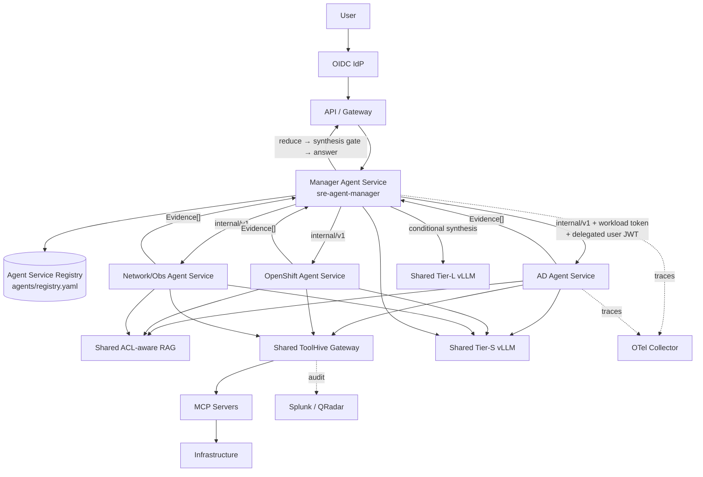

# Air-Gapped SRE Agent Platform — Architecture, Revision 2.0

**Status:** Adopted for PoC (implemented)
**Supersedes:** Revision 1.1 (`docs/architecture.md`) **only** in deployment
topology, identity propagation, and network design. Every other principle,
ADR, red line, and control in Rev 1.1 remains in force unchanged. Rev 1.1 is
preserved as-is; read it first.

---

## 1. What changed and what did not

| Area | Rev 1.1 | Rev 2.0 |
|---|---|---|
| Deployment unit | one runtime process executes Manager and all specialists | **every logical Agent is its own OpenShift Deployment + Service** |
| Fan-out | local `Promise.allSettled(runSpecialist(...))` | `Promise.allSettled(agentClient.execute(agentId, request, signal))` over HTTP |
| Manager ↔ specialist contract | in-process function call | versioned internal Agent API (`docs/contracts/internal-agent-api.md`) |
| Agent resolution | in-process config registry | Agent Service Registry (`agents/registry.yaml` → Service DNS) |
| Identity across hops | single process, no extra hop | dual credential: workload identity + audience-bound delegated user JWT |
| Network policy | one pod egress profile | per-agent NetworkPolicy; manager has **no** ToolHive/RAG egress |
| Everything else | — | **unchanged**: one-shot Manager, deterministic control plane, read-only capability, ACL-aware RAG, typed `Evidence[]`, redaction, bounded Round 2, conditional Tier-L, red lines |

## 2. The core distinction

> **Independent Deployment does not mean independent implementation.**

```text
1 Runtime codebase        (packages/*, apps/api)
1 Runtime image           (registry.internal/sre-agent-runtime:<tag>)
1 Generic Helm chart      (deploy/helm)
N Agent YAML configs      (agents/*.yaml)
N Deployments             (sre-agent-manager, sre-agent-active-directory, ...)
N Services                (one per agent, DNS = registry endpoint)
```

Not: N repositories, N runtime implementations, N images, N orchestration
stacks. The runtime image contains no agent-specific business logic; behavior
is selected at startup by `AGENT_CONFIG=<agent yaml>`, which loads exactly one
agent configuration and initializes only that mode's dependencies. A
specialist process never loads other specialists' configurations; the manager
loads only lightweight registry metadata.

## 3. Target architecture



The Manager deployment owns: Stage-1 deterministic routing, the optional
one-shot Manager LLM call, authorization filtering, bounded parallel fan-out,
`SpecialistResult` collection, `needsDomain` validation and bounded Round 2,
evidence reduction, the synthesis gate, and response construction. It has no
MCP or RAG dependency in its process and no network path to them.

## 4. Identity propagation across the new hop

The extra network hop must not weaken Gate #1. The design keeps two
independent assertions on every internal call:

1. **Service identity** — the manager authenticates itself to the specialist
   with a short-lived projected ServiceAccount/OIDC token (audience
   `sre-agent-runtime`). Specialists reject calls from anything that is not
   the manager workload; NetworkPolicy enforces the same at L3/4.
2. **Delegated human identity** — a per-target JWT (`sre-agent:<agentId>`
   audience, ≤ 60 s, `request_id` + `subjectHash` bound) carries the effective
   user's subject/groups/roles. The specialist verifies it cryptographically —
   an unsigned identity claim from the manager is never trusted — and passes
   the verified identity to ToolHive, which authorizes every tool call against
   the human principal.

The production issuer is the enterprise token-exchange service (RS256 + JWKS);
the PoC ships a mock authority with identical semantics. Gate #1 is unchanged
in substance and now reads: *the human identity and authorization context must
be provable through API → Manager → Specialist → ToolHive → MCP, with
distinguishable audit identities per user and per agent hop.*

## 5. Network segmentation — the security win of this model

Per-agent ServiceAccount and NetworkPolicy make the least-privilege story
structural:

```text
API namespace      → manager :3000                      (only permitted ingress)
manager            → specialist pods :3000, vLLM, IdP, PostgreSQL, OTel
specialist         ← manager pods only
specialist         → ToolHive, RAG, vLLM, OTel          (never other agent pods)
manager            ✗ ToolHive, ✗ RAG                    (no data-plane aggregation)
```

The manager never accumulates the combined backend reach of all thirteen
teams; compromising it yields routing, not tool access. Specialist-to-
specialist calls are impossible at three layers: code (no client), identity
(audience binding), and network (policy).

## 6. What stays shared — and why

| Component | Stays shared | Reason |
|---|---|---|
| Tier-S / Tier-L vLLM | yes | N copies of the same 3–8B/70B model waste GPUs; agents are application runtimes, not hosted LLMs |
| RAG service | yes | one ACL-enforcing retrieval plane; specialists pass their authorized collections |
| ToolHive gateway | yes | single MCP policy/audit chokepoint (ADR-007) |
| Observability stack | yes | one distributed trace per request requires one collector |
| PostgreSQL (sessions) | yes | bounded session context is manager-owned state |
| Runtime image + Helm chart | yes | the whole point — see §2 |

## 7. Trade-off assessment (why this is better here)

| Dimension | Shared process | Per-agent Deployment | Verdict |
|---|---|---|---|
| Fault isolation | one bad specialist can destabilize all | unhealthy DBA agent ≠ unhealthy AD agent | **per-agent** |
| Scaling | one knob for all workloads | observability agent ×4, DBA ×1, per-agent HPA | **per-agent** |
| Blast radius (security) | process holds union of network reach | per-agent SA/NetworkPolicy; manager loses data-plane access | **per-agent** |
| Ownership | teams share one deployment | team owns its values/config rollout without owning the runtime | **per-agent** |
| Resource overhead | one pod set | N pod sets (~250m/256Mi requests each) | shared, mildly |
| Latency | function call (~0) | +1 in-cluster HTTP hop (~1–5 ms) vs multi-second LLM/MCP stages | negligible |
| AuthN complexity | none internally | workload + delegation tokens | shared — accepted cost, and it *improves* auditability |
| Observability | simpler | needs W3C context propagation (implemented) | tie |
| Operational count | 1 Deployment | N Deployments from one chart via GitOps | shared, mildly |
| Upgrade | one rollout | N rollouts of one image (can be batched) | tie |

The costs land in cheap dimensions (millicores, a few milliseconds, GitOps
plumbing); the gains land in the expensive ones (blast radius, fault
isolation, per-team ownership). Adopted.

## 8. New architecture decisions

### ADR-013 — One Deployment per logical Agent, one shared runtime image
Each agent runs as its own Deployment/Service from the single generic runtime
image, configured by one mounted/baked agent YAML. Rationale: §5, §7.
Revisit if the per-namespace deployment count becomes an operational burden
before Phase 2.

### ADR-014 — Dual-credential identity propagation
Manager→specialist calls carry workload identity and an audience-bound,
short-lived delegated user JWT; specialists verify both and never accept
unsigned identity. Enterprise token exchange is the production issuer.

### ADR-015 — Models, RAG, ToolHive, and observability remain shared platform services
Agents are independently deployed application runtimes, not independently
hosted LLMs or gateways.

### ADR-016 — Plain typed HTTP for the internal Agent API; no A2A
One trust domain, one owned runtime: a versioned strict-schema HTTP contract
(`internal/v1`) is sufficient. A2A, buses, and workflow engines remain out of
scope per the Rev 1.1 red lines, which distribution does not relax.

## 9. Red lines — restated

Distribution is not a license for orchestration frameworks. All Rev 1.1 /
TDD §34 red lines hold verbatim: no workflow graphs, no configurable loops, no
durable executions, no pause/resume, no specialist-to-specialist invocation,
no dynamic code, no write actions. If the distributed model appears to demand
one of these, raise an architecture decision — do not extend the runtime.
