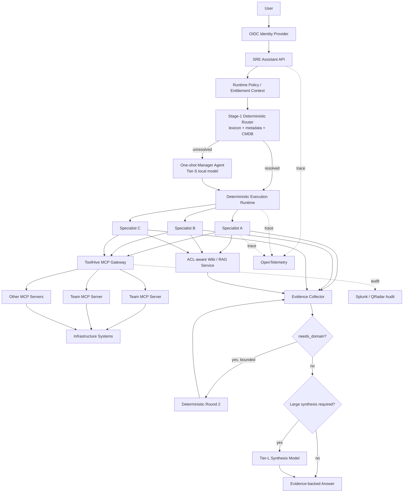
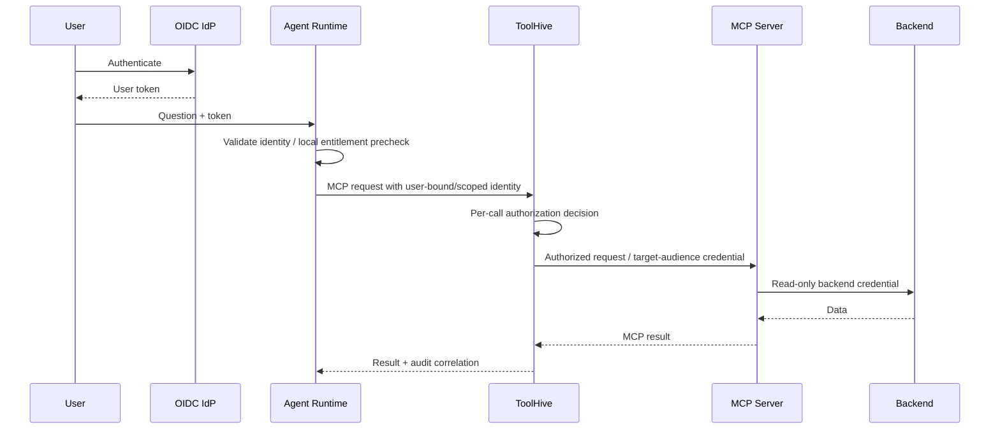

# Air-Gapped SRE Agent Platform — Architecture

**Status:** Proposed architecture for PoC / Architecture Review  
**Document revision:** 1.1  
**Phase:** Phase 1 — read-only Q&A  
**Deployment target:** On-premises OpenShift, fully air-gapped  
**Primary runtime:** Generic TypeScript Agent Runtime  
**Agent configuration:** YAML / Git as source of truth  
**MCP gateway:** ToolHive  
**Model serving:** Local OpenAI-compatible endpoints (for example vLLM)  

---

## 1. Executive summary

The proposed system is an internal, air-gapped SRE assistant that answers natural-language infrastructure questions using two evidence sources:

1. **Internal knowledge** — runbooks, standards, procedures, ownership information, and other wiki content retrieved through an ACL-aware RAG service.
2. **Live infrastructure state** — read-only queries against enterprise tools exposed as MCP servers through ToolHive.

The core design is a **small, generic TypeScript Agent Runtime** rather than n8n or a heavyweight agent-orchestration framework in the interactive request path.

The runtime supports two agent modes using the same implementation:

- **Manager** — a tightly bounded, one-shot routing agent that selects which specialist agents should participate. It does not write free-form tasks for specialists, does not authorize actions, and does not access an unrestricted tool catalog.
- **Specialist** — a team/domain-specific agent configured through YAML with its own system prompt, RAG scope, MCP servers, curated tool subset, model tier, and execution limits.

The intended control principle is:

> **The Manager decides what should happen. The runtime decides what is allowed to happen and how it happens.**

The Manager therefore returns only a structured routing decision such as selected agents and confidence. Each specialist receives the **original user question**, its own trusted system prompt, authorized context, baseline wiki evidence, and a curated tool set.

A specialist may report that another domain is required through a structured `needs_domain` field. A second round is then triggered **deterministically by runtime code**, with a hard global cap. Specialists never invoke one another directly.

Phase 1 is read-only by capability, not by prompt. Authorization is external to the LLM and is enforced at multiple layers, including ToolHive and backend credentials.

---

## 2. Scope

### 2.1 Infrastructure teams

The platform is intended to serve thirteen infrastructure teams:

1. Network communication — switches, routers, load balancers
2. Network security — firewalls, Check Point, NSX
3. Storage and virtualization
4. Domain services — Windows AD and identity
5. Endpoint — Windows servers/workstations, Exchange, SCCM
6. Linux and platform / internal developer platform
7. Perimeter — F5 BIG-IP, DDoS protection
8. Insight / observability — Prometheus, Splunk, QRadar
9. Security — Trellix, NAC
10. PaaS — OpenShift
11. Ops — ZooKeeper, Kafka, Redis, GitOps
12. DBA
13. DevOps — Atlassian tooling, Argo CD

### 2.2 Phase 1 goals

Phase 1 must:

- answer natural-language infrastructure questions;
- identify the relevant specialist agent or agents;
- retrieve relevant internal wiki knowledge;
- query live systems through read-only MCP tools;
- combine all returned information into typed evidence;
- provide evidence-backed answers with provenance and visible data gaps;
- enforce per-user authorization independently of routing;
- run entirely offline on OpenShift;
- use small local models for routing and specialist tool calling;
- invoke a larger local model only when synthesis materially requires it;
- remain observable, auditable, testable, and replayable.

### 2.3 Non-goals for Phase 1

Phase 1 will not:

- modify infrastructure;
- restart, create, patch, delete, deploy, or remediate resources;
- let an LLM grant access or widen its own tool set;
- expose a global tool catalog to any model;
- allow specialists to invoke other specialists directly;
- implement autonomous root-cause analysis as a guaranteed capability;
- implement open-ended agent-to-agent conversations;
- introduce A2A inside the single platform trust boundary;
- use n8n as the synchronous interactive agent runtime;
- implement a workflow DSL in YAML.

### 2.4 Conversation model for Phase 1

Phase 1 is **single-request execution with bounded conversational context**, not a persistent autonomous conversation.

A follow-up such as “what about DC2?” may reference the immediately preceding user-visible answer and explicitly retained conversation entities, but prior model transcripts are **not** reused as control state and prior Evidence is **not** silently trusted as current evidence.

For a follow-up request:

1. the API resolves explicit conversational references such as `DC2` against a bounded session context;
2. routing runs again for the new request;
3. live evidence is refreshed unless a source-specific freshness policy explicitly permits reuse;
4. reused evidence retains its original `observedAt` and is marked as reused/cached;
5. authorization is re-evaluated for the current user and request;
6. the runtime does not expose another user’s session state.

Phase 1 does **not** implement long-term agent memory, cross-session autonomous memory, or transcript-driven planning. If product requirements require durable agent memory or memory-dependent orchestration, revisit the runtime boundary before adding it.

---

## 3. Architectural principles

### 3.1 Deterministic guardrails around probabilistic reasoning

LLMs are used only where semantic reasoning provides value. Control-plane responsibilities remain normal application code:

- authentication;
- authorization;
- tool visibility;
- timeout budgets;
- retries;
- parallelism;
- circuit breaking;
- evidence status;
- fan-out limits;
- second-round limits;
- large-model escalation rules;
- audit correlation.

### 3.2 Semantic routing is not authorization

A routing decision only identifies which specialist should investigate a question. It never grants access.

Every downstream operation is evaluated independently using the human user's identity and entitlements.

### 3.3 Small models see small action spaces

At each model decision point, expose only a curated set of roughly **5–15 relevant tools**, subject to PoC validation.

The full ToolHive/MCP catalog must never be sent to a specialist model.

### 3.4 Retrieved and tool-returned content is untrusted data

Wiki text, log lines, object descriptions, alert annotations, CLI output, and tool payloads are data, not instructions.

External content must never be able to:

- alter authorization;
- widen tool scope;
- register new tools;
- change the Manager's allowed agent registry;
- override the system prompt;
- create a write capability.

### 3.5 Evidence, not transcripts, crosses boundaries

Agents exchange typed evidence and structured results. They do not pass complete agent conversation histories to one another.

### 3.6 YAML defines WHAT; TypeScript defines HOW

YAML configures an agent. TypeScript implements execution semantics.

The YAML format must not evolve into a general-purpose workflow language.

---

## 4. High-level architecture



---

## 5. End-to-end request flow

### Step 1 — Authenticate the human

The user authenticates through the enterprise OIDC provider.

The API establishes a trusted request context containing at minimum:

```ts
interface RequestIdentity {
  subject: string;
  groups: string[];
  roles: string[];
  requestId: string;
  sessionId?: string;
}
```

The user identity is never replaced by a generic orchestrator identity for downstream authorization decisions.

### Step 2 — Run Stage-1 deterministic routing

Before calling any routing model, deterministic code enriches the request with trusted metadata and attempts **high-precision routing** using:

- exact infrastructure terminology and curated phrase mappings;
- recognized hostnames and naming conventions;
- CMDB/application ownership;
- known service identifiers;
- explicit user-selected environment or team;
- deterministic entitlement filtering.

Examples:

```text
"AD replication"       → Domain Services
"Kafka consumer lag"   → Ops
"Check Point VSX"      → Network Security
```

Stage 1 is tuned for **precision rather than coverage**. It must not guess on overloaded terms such as `cluster`, `policy`, `replication`, or `certificate`.

If Stage 1 resolves a single authorized specialist with sufficiently strong deterministic evidence, the runtime may bypass the Manager entirely. If not, the request proceeds to Stage 2.

### Step 3 — Run the one-shot Manager for unresolved routing

The Manager receives:

- the original user question;
- the list of **authorized and available specialist agents**;
- concise specialist descriptions;
- trusted metadata;
- a strict structured output schema.

The Manager does **not** generate a free-form `task` for each specialist.

Recommended output:

```ts
interface ManagerDecision {
  agents: string[];
  confidence: number;
  alternates?: string[];
  abstain: boolean;
  reasonCodes?: string[];
}
```

Constraints are enforced by code:

- maximum selected agents per round;
- agent IDs must exist in the authorized registry;
- schema validation is mandatory;
- Manager output is enforced at the serving layer using vLLM structured/guided JSON output where supported, then validated again in TypeScript;
- low-confidence/ambiguous cases may abstain;
- invalid selections are rejected before execution.

`abstain: true` has explicit runtime semantics:

1. if the Manager returns one or more bounded `alternates` that are all authorized and the ambiguity is safe to fan out, the runtime may execute the top two candidates;
2. otherwise the API asks the user a clarification question and performs **no speculative tool calls**.

The decision between clarification and top-2 fan-out is deterministic runtime policy, not another Manager turn.

### Step 4 — Execute selected specialists in parallel

The runtime invokes authorized specialists concurrently.

Each specialist receives:

- original user question;
- trusted request metadata;
- specialist system prompt;
- baseline wiki evidence for its scope;
- its curated, authorized MCP tool subset;
- execution budget;
- correlation/request ID.

It does **not** receive free-form instructions written by the Manager.

Parallelism should use normal runtime primitives such as `Promise.allSettled` rather than an autonomous orchestration loop.

### Step 5 — Specialist returns structured result

Example:

```ts
interface SpecialistResult {
  agentId: string;
  status: "complete" | "partial" | "failed";
  evidence: Evidence[];
  summary?: string;
  needsDomain?: string[];
  missing?: string[];
}
```

### Step 6 — Optional discovered-routing round

If a specialist discovers that another domain is necessary, it may return `needsDomain`.

The specialist does not invoke that domain itself.

The runtime:

1. validates the requested domain against the domain registry;
2. checks the human's authorization;
3. checks whether the global round/agent budget permits it;
4. maps the domain to eligible specialists;
5. launches a second and final bounded round.

**Round-2 context rule:** the new specialist receives the original user question plus a **sanitized, typed handoff context** derived from Round-1 Evidence — never the originating specialist transcript and never raw untrusted payloads by default. The handoff may include entity IDs, source references, status codes, and bounded redacted excerpts required to explain why the domain was requested.

`needsDomain` can add at most **one additional domain per originating specialist**, only from the registered domain set, only after AuthZ, and only within the global request budget. It cannot widen permissions, create new tools, or trigger Round 3.

This is the mechanism for evidence-discovered routing without an iterative supervisor.

### Step 7 — Reduce evidence

The reducer is normal TypeScript code. It:

- combines evidence objects;
- preserves provenance;
- detects missing sources;
- detects stale data;
- detects wiki/live conflicts;
- detects environment mismatches;
- deduplicates equivalent evidence;
- marks evidence completeness.

### Step 8 — Conditional synthesis

A large local model is not invoked automatically.

Escalation candidates include:

- multiple contributing domains;
- conflicting evidence;
- incomplete or stale evidence;
- diagnostic/causal questions;
- complex answer composition.

Single-team factual questions with complete evidence should normally terminate without Tier-L synthesis.

The actual escalation rate must be measured in the PoC rather than hard-coded as a product assumption.

### Step 9 — Return an evidence-backed answer

The response should clearly distinguish:

- documented intended state;
- live observed state;
- stale state;
- missing sources;
- access-denied sources;
- conflicts.

A wiki-only response must never appear to be a live-health answer.

---

## 5.1 Why a thin TypeScript runtime instead of LangGraph/PydanticAI

This is a deliberate architecture decision, not an assumption that custom code is inherently simpler.

### Decision

For Phase 1, use a thin TypeScript runtime because the required control flow is intentionally constrained to:

```text
high-precision deterministic routing
→ optional one-shot Manager selection
→ bounded parallel fan-out
→ Evidence[] reduction
→ optional single discovered-routing round
→ conditional synthesis
```

The platform does **not** currently require a general graph/state-machine abstraction.

### Why not PydanticAI as the primary runtime

The capabilities that materially matter in Phase 1 — schema validation, structured output, bounded retries, MCP client access, tool filtering, cancellation, telemetry, and parallel I/O — have mature TypeScript primitives/libraries and do not by themselves justify making a fast-moving Python agent framework the platform boundary. The custom runtime must still use mature libraries rather than reimplement protocol/schema/telemetry foundations.

PydanticAI remains a valid PoC baseline and should be reconsidered if the internal runtime grows beyond the red lines below.

### Why not LangGraph as the primary runtime

LangGraph is stronger when the product requires explicit graphs, durable state, resumability, subgraphs, conditional workflow composition, or complex multi-step orchestration. Phase 1 intentionally avoids those requirements. Introducing graph semantics now would add an abstraction and lifecycle dependency without a demonstrated control-flow need.

### Phase-1 framework red lines

Stop extending the custom runtime and reassess a framework/engine **even during Phase 1** if implementation starts requiring:

- agent memory that changes future routing/execution decisions;
- framework-like streaming orchestration across multiple concurrent agent states;
- reusable subgraph/workflow composition;
- configurable branching/loops;
- persistent execution checkpoints/resume;
- generalized planner/executor semantics.

The intended runtime is a thin application runtime, not an internally developed agent framework.

---

## 6. Generic TypeScript Agent Runtime

### 6.1 Objective

Implement one runtime that executes both Manager and specialist configurations without creating separate codebases per team.

### 6.2 Core runtime modules

```text
src/
├── api/
├── auth/
├── config/
├── manager/
├── specialist/
├── models/
├── mcp/
├── rag/
├── evidence/
├── execution/
├── policy/
├── telemetry/
└── errors/
```

Recommended responsibilities:

| Module | Responsibility |
|---|---|
| `api` | HTTP/SSE API, request lifecycle, cancellation |
| `auth` | OIDC token validation, identity context |
| `config` | YAML load, schema validation, versioning |
| `manager` | one-shot structured routing call |
| `specialist` | bounded tool-calling loop |
| `models` | OpenAI-compatible model abstraction |
| `mcp` | ToolHive MCP client/session/schema handling |
| `rag` | deterministic retrieval client |
| `evidence` | evidence normalization and reducer |
| `execution` | fan-out, timeout budgets, round caps |
| `policy` | local prechecks; never replaces gateway enforcement |
| `telemetry` | OTel traces/metrics/log correlation |
| `errors` | typed error taxonomy |

### 6.3 Suggested TypeScript stack

Reference stack, subject to PoC and enterprise dependency review:

- TypeScript
- Node.js LTS runtime
- Fastify or Hono for the API layer
- Zod and/or JSON Schema for runtime validation
- official MCP TypeScript SDK
- OpenAI-compatible model client
- optional structured-output/retry library such as Instructor for TS if validated internally
- OpenTelemetry SDK
- YAML parser
- PostgreSQL client
- `AbortController` / native cancellation primitives

TypeScript is selected for platform ergonomics, typed config/runtime boundaries, I/O concurrency, MCP ecosystem alignment, and future GUI/backend model reuse — **not** because the TypeScript 7 compiler is implemented in Go.

---

## 7. Agent configuration model

### 7.1 Specialist YAML

```yaml
apiVersion: sre.ai/v1alpha1
kind: Agent
metadata:
  name: active-directory
  owner: domain-services

spec:
  type: specialist

  model:
    tier: small
    profile: tool-caller-default

  prompt:
    systemFile: prompts/active-directory.md

  rag:
    enabled: true
    collections:
      - ad-wiki
    baselineRetrieval: true
    maxFollowupRetrievals: 1
    topK: 8

  mcp:
    servers:
      - active-directory
      - splunk
      - prometheus
    allowedTools:
      - get_replication_status
      - get_dc_health
      - search_ad_events
      - query_prometheus

  execution:
    maxToolCalls: 6
    maxModelTurns: 3
    timeoutSeconds: 25

  routing:
    domains:
      - identity

  authorization:
    requiredRoles:
      - infra-read
```

### 7.2 Manager YAML

```yaml
apiVersion: sre.ai/v1alpha1
kind: Agent
metadata:
  name: sre-manager
  owner: sre-platform

spec:
  type: manager

  model:
    tier: small
    profile: router-default

  prompt:
    systemFile: prompts/manager.md

  agents:
    registry:
      - active-directory
      - endpoint
      - network-communication
      - network-security
      - perimeter
      - openshift
      - linux-platform
      - storage-virtualization
      - observability
      - security
      - ops
      - dba
      - devops

  execution:
    maxAgentsPerRound: 3
    maxRounds: 2
    managerCallsPerRequest: 1
    parallel: true

  output:
    mode: selection-only
```

### 7.3 What YAML may contain

Allowed declarative concerns:

- agent identity and owner;
- agent type;
- model profile;
- prompt reference;
- RAG collections;
- MCP server references;
- tool allowlist;
- execution budgets;
- routing metadata;
- authorization metadata;
- feature flags.

### 7.4 What YAML must not contain

Do not add:

- `if`/`else` workflow logic;
- loops;
- embedded JavaScript/TypeScript/Python;
- arbitrary expressions;
- custom-code escape hatches;
- durable workflow state machines;
- specialist-to-specialist invocation graphs;
- retry algorithms;
- persistence/resume logic.

If these become requirements, introduce an appropriate orchestration/workflow engine rather than turning YAML into one.

---

## 8. Manager Agent design

### 8.1 Responsibilities

The Manager is responsible for semantic selection only:

- identify which specialists are likely needed;
- select a bounded set;
- provide confidence/abstention;
- optionally expose reason codes for audit/diagnostics.

### 8.2 Non-responsibilities

The Manager does not:

- authorize tools;
- discover an unrestricted tool catalog;
- generate specialist prompts/tasks;
- call infrastructure MCP tools directly by default;
- loop over specialist responses;
- decide retry policy;
- decide timeout policy;
- persist workflow state;
- modify infrastructure.

### 8.3 Why selection-only

Generating specialist task text introduces an unnecessary generation step and creates an instruction channel from one probabilistic model into another.

Specialists already have:

- the original user question;
- their own trusted system prompt;
- their domain-specific knowledge and tools.

Therefore the Manager should select specialists, not rewrite the user's intent.

### 8.4 Structured output enforcement

Manager decisions and specialist control fields such as `needsDomain` must use schema-constrained generation at the serving layer where supported.

For vLLM, the preferred pattern is guided/structured JSON output using the pinned version's supported structured-output API, followed by TypeScript schema validation. Parse-and-retry is a fallback, not the primary control for these short control-plane outputs.

The exact vLLM flags/API names are version-sensitive and must be verified against the mirrored serving version during PoC.

### 8.5 Ambiguity

For low-confidence questions the Manager may:

- select top-2 candidates within the configured limit; or
- abstain and ask the user to clarify.

Confidently selecting one arbitrary domain is not an acceptable ambiguity strategy.

---

## 9. Specialist Agent design

Each specialist is a bounded tool-using agent instantiated from YAML.

### 9.1 Input

- original question;
- user-authorized context;
- trusted metadata;
- baseline wiki evidence;
- 5–15 curated tools;
- system prompt;
- execution budget.

### 9.2 Tool loop

The runtime owns the loop limits. A specialist may select and call tools, but only inside a bounded execution envelope.

Example envelope:

```ts
interface ExecutionBudget {
  maxToolCalls: number;
  maxModelTurns: number;
  deadlineMs: number;
}
```

### 9.3 Discovered routing

A specialist may declare:

```json
{
  "needsDomain": ["network"]
}
```

This is a request to the runtime, not an invocation.

### 9.4 No specialist-to-specialist calls

All cross-agent execution returns through the Manager/runtime control plane.

This preserves:

- authorization checks;
- bounded fan-out;
- traceability;
- prevention of recursive agent graphs;
- deterministic round limits.

---

## 10. Wiki / RAG architecture

### 10.1 Retrieval is a platform service, not merely another optional agent tool

Every specialist with RAG enabled receives an **always-on baseline retrieval** before or alongside its first reasoning step.

This ensures that wiki grounding is:

- auditable;
- repeatable;
- visible in traces;
- not silently skipped by a small model.

### 10.2 Retrieval flow

```mermaid
flowchart LR
    Q[Original Question] --> ACL[Identity / ACL Filter]
    ACL --> BM[BM25 / lexical]
    ACL --> DEN[Dense retrieval]
    BM --> RRF[Reciprocal Rank Fusion]
    DEN --> RRF
    RRF --> RR[Reranker]
    RR --> TOP[Top authorized chunks]
    TOP --> EV[Wiki Evidence[]]
```

Reference implementation from the prior research:

- lexical + dense hybrid retrieval;
- Reciprocal Rank Fusion;
- rerank top candidates;
- BGE-M3 as an embedding candidate;
- `bge-reranker-v2-m3` as a reranker candidate;
- pgvector as the low-operational-burden reference store;
- Qdrant as an alternative if scale/search requirements justify it.

These model/store choices are PoC inputs, not immutable architecture decisions.

### 10.3 ACL enforcement

Document permissions must be enforced **inside retrieval at query time**.

Do not retrieve unauthorized chunks and attempt to filter them only after ranking or after generation.

The retrieval index therefore needs security metadata sufficient to reproduce the wiki's access model.

### 10.4 Follow-up retrieval

Allow at most one bounded specialist-initiated follow-up retrieval in Phase 1.

Use case:

1. question asks about an application;
2. live telemetry reveals hostname `APP-PRD-114`;
3. specialist requests the runbook for that newly discovered entity.

The follow-up query is still ACL-filtered and becomes evidence.

### 10.5 Wiki ingestion pipeline

Wiki ingestion is asynchronous and can be run outside the interactive runtime, for example with n8n or dedicated indexing jobs.

Ingestion responsibilities:

- fetch authorized wiki content;
- preserve source URL/document ID;
- preserve ACL metadata;
- preserve last-modified timestamp;
- sanitize HTML/Markdown;
- Unicode normalization;
- detect/flag suspicious instruction-shaped content;
- chunk;
- embed/index;
- update/delete changed documents.

---

## 11. MCP and ToolHive architecture

### 11.1 Boundary

The Agent Runtime should not contain direct vendor-specific integrations.

```text
Specialist
   ↓
Agent Runtime MCP Client
   ↓
ToolHive
   ↓
MCP Server
   ↓
Vendor / Infrastructure API
```

### 11.2 ToolHive responsibilities

ToolHive should own or enforce:

- MCP server connectivity and lifecycle;
- gateway-side tool visibility;
- authentication integration;
- per-call authorization policy;
- rate limiting;
- gateway audit logging;
- server-level isolation;
- tool configuration/allowlists;
- MCP telemetry where applicable.

### 11.3 Runtime MCP responsibilities

The Agent Runtime owns:

- choosing from the already authorized specialist tool subset;
- MCP session/client lifecycle from the application side;
- request correlation;
- time budgets;
- tool argument validation;
- evidence normalization;
- handling returned errors;
- parallel specialist execution.

### 11.4 Tool discovery and schema caching

Tool schemas may be cached for performance, but the cache must be scoped by:

- MCP server;
- config/version;
- authorization/tool view where relevant.

A stale schema must never widen access.

### 11.5 Retry ownership

Retries must have **one owner**.

Recommended Phase 1 rule:

- the Agent Runtime owns application-level retries;
- retry at most once for connection failures and eligible 5xx failures;
- do not retry 4xx, authorization denials, or deterministic query syntax errors;
- ToolHive should not independently create an invisible second application retry loop.

If ToolHive performs transport retries internally, those must be documented and counted in the request budget.

---

## 12. Authentication and authorization

### 12.1 Authentication

OIDC answers: **Who is this user?**

Authorization answers: **What may this user access?**

They are separate controls.

### 12.2 Authorization flow



### 12.3 Per-call authorization dimensions

Authorization policy may evaluate:

```text
principal/user
team/group
role
environment
agent
MCP server
tool
method
resource
```

### 12.4 Confused deputy prevention

Do not let the platform call ToolHive using a single service identity that holds the union of all thirteen teams' permissions.

The human's identity/entitlement context must survive the hop chain in a form that ToolHive and the target MCP server can validate.

Use audience-scoped credentials/token exchange rather than forwarding one upstream bearer token unchanged across trust boundaries.

The exact enterprise IdP implementation is a PoC validation item.

### 12.5 Cedar vs OPA

Two acceptable models:

- ToolHive-native authorization policy where it satisfies the required policy model;
- ToolHive delegation to an external policy decision point such as OPA when enterprise-wide policy reuse is required.

Do not build a custom authorization engine unless an existing policy engine demonstrably cannot express the required policy.

---

## 13. Read-only enforcement

Phase 1 read-only is enforced in three independent layers.

### Layer 1 — verified tool exposure

Only tools whose underlying behavior has been reviewed and verified as read-only are registered/exposed.

Tool names such as `get_*` or metadata such as `readOnlyHint` are documentation, not security controls.

Mutating capabilities should not exist in the discoverable Phase 1 catalog.

### Layer 2 — backend credentials

Each MCP server authenticates to its backend with credentials that cannot mutate state.

Examples include read-only/auditor/search-only roles appropriate to the installed backend version.

### Layer 3 — network/API policy

Use default-deny egress and explicit destination/path policy.

Do not rely on HTTP verbs alone because legitimate read operations may use POST.

Allow required read endpoints explicitly and deny mutation paths.

---

## 14. Evidence and provenance model

One evidence type is carried through every stage.

```ts
interface Evidence {
  id: string;
  kind: "wiki" | "telemetry" | "config" | "missing";
  source: string;
  system: string;
  environment: "prod" | "dr" | "lab" | string;

  observedAt?: string;
  sourceModifiedAt?: string;

  query?: string;
  tool?: string;
  payload?: unknown;
  rawExcerpt?: string;
  redacted?: boolean;
  redactionTypes?: string[];

  confidence?: number;
  citation: string;

  status: "ok" | "empty" | "missing" | "failed" | "stale" | "denied";
  requestId: string;
}
```

### 14.1 Required distinctions

The model must distinguish:

- **observedAt** — when a live system was queried;
- **sourceModifiedAt** — when a source document/config was last updated;
- `empty` — query succeeded but returned no rows;
- `missing` — source unavailable or not queried successfully;
- `failed` — query execution failed;
- `denied` — authorization prevented access;
- `stale` — evidence exists but exceeds freshness policy.

### 14.2 Citation behavior

The synthesizer should consume pre-built citation metadata from Evidence rather than inventing citations from prose.

Every material claim in the answer should map to one or more evidence objects.

---

## 15. Prompt-injection and untrusted-content controls

### 15.1 Structural controls

Before untrusted external content enters specialist context, the runtime already fixes:

- user identity;
- authorized specialist set;
- specialist tool subset;
- hard execution budget.

External text cannot change these values.

### 15.2 Data/instruction separation

Wiki and tool content is wrapped in clearly typed evidence blocks and never inserted as system instructions.

### 15.3 Ingestion sanitization

At wiki ingestion time:

- sanitize HTML/Markdown;
- normalize Unicode;
- strip or flag bidi/zero-width/confusable abuse;
- detect suspicious instruction-shaped text;
- preserve the raw source for audit.

### 15.4 Secret / sensitive-data redaction before model context

Live tool results and wiki/config content may contain credentials, tokens, connection strings, private keys, session identifiers, PII, or other sensitive values even when the underlying operation is read-only.

Before any `payload`, `rawExcerpt`, or retrieved chunk is placed into Tier-S or Tier-L model context, the runtime passes it through a **redaction/DLP boundary**.

Minimum controls:

- deterministic patterns for known secret formats;
- integration with the enterprise DLP/secret-detection capability where available;
- field-level redaction based on MCP/tool schema metadata;
- bounded excerpts instead of full payloads;
- redaction before cross-domain Round-2 handoff;
- separate protected raw audit storage only when operationally required and authorized;
- explicit marking in Evidence when content has been redacted.

The model-visible `Evidence` representation is therefore not necessarily the raw backend payload.

### 15.5 Residual risk

Even with hard authorization, prompt injection may still corrupt an answer or cause an otherwise allowed call to be skipped/selected incorrectly.

Mitigations:

- mandatory citations;
- expected-evidence checks for important query classes;
- unsupported-claim evaluation;
- visible raw evidence in the UI;
- strict read-only scope in Phase 1.

---

## 16. Model tiers

### Tier-S — small routing/tool model

Used for:

- Manager selection;
- specialist tool selection/reasoning;
- optional structured extraction.

Target class: 3–8B local instruct/tool-calling model.

Serving requirements:

- OpenAI-compatible vLLM endpoint;
- model-matched tool parser/template;
- structured/guided JSON output **required** for Manager decisions and specialist control outputs such as `needsDomain` where supported;
- concurrency/load testing.

Small-model tool reliability remains a PoC gate and must not be inferred merely from API compatibility.

### Tier-L — large synthesis model

Used only when the answer requires cross-domain or complex synthesis.

It should not be on the hot path for simple, complete single-specialist factual queries.

### Tier-E — embeddings/reranking

Dedicated retrieval model(s), operationally separated from Tier-S GPU capacity where practical.

---

## 17. OpenShift deployment layout

Recommended logical namespaces:

```text
sre-assistant
├── api
├── agent-runtime
├── rag-service
├── config-controller / config loader
└── future UI

sre-mcp
├── ToolHive operator/gateway
├── AD MCP
├── Network MCP
├── Splunk MCP
├── Prometheus MCP
├── OpenShift MCP
└── ...

sre-models
├── vLLM Tier-S
├── vLLM Tier-L
└── embedding/reranker serving

sre-data
├── PostgreSQL / pgvector
└── config/eval metadata as needed

sre-observability
├── OpenTelemetry Collector
├── self-hosted LLM tracing platform
└── supporting datastore(s)
```

### 17.1 Network policy

- default-deny egress;
- MCP server pods may reach only their target backends and required identity endpoints;
- model-serving namespace has no internet egress;
- assistant runtime can reach only approved internal services;
- wiki/indexing flows are explicit.

### 17.2 Air-gap supply chain

All images and packages must be mirrored internally:

- Node base images;
- npm packages or internal npm proxy/mirror;
- ToolHive operator/chart/images;
- MCP server images;
- model-serving images;
- model weights;
- embedding/reranking models;
- observability images.

Pin versions and define an explicit upgrade/revalidation process.

---

## 18. Observability and audit

### 18.1 OpenTelemetry from day one

Create spans for:

- API request;
- Manager call;
- baseline retrieval;
- reranking;
- each specialist execution;
- each model call;
- each MCP call;
- evidence reduction;
- second-round decision;
- large synthesis;
- response rendering.

### 18.2 Common correlation ID

Generate one `request_id` at ingress and propagate it through:

```text
API
→ Manager
→ Specialists
→ RAG
→ ToolHive
→ MCP
→ audit logs
```

Where supported, propagate the ID as MCP metadata/header so ToolHive audit events can be joined to application traces.

### 18.3 Trace vs security audit

Keep them separate:

- LLM/application traces → self-hosted observability stack;
- authorization decisions/tool access → Splunk/QRadar/security audit.

Security audit is the source of truth for who called what and whether it was allowed.

### 18.4 Key metrics

- p50/p95 end-to-end latency;
- routing latency;
- retrieval latency;
- MCP latency by server/tool;
- model latency by tier;
- tool calls/request;
- model calls/request;
- large-model escalation rate;
- invalid MCP call rate;
- retries;
- timeouts;
- denied tool calls;
- missing evidence rate;
- unsupported claim rate;
- GPU-seconds/request;
- pass@1 / pass^k routing stability.

---

## 19. Failure handling

### 19.1 Principle

Missing evidence must be visible. The system must never silently synthesize around unavailable sources.

### 19.2 Isolation

- one circuit breaker per MCP server;
- independent connection pools/bulkheads;
- one failing data source does not cancel unrelated evidence gathering.

### 19.3 Timeout policy

Use per-tool deadlines plus a whole-request deadline.

Example starting point for PoC:

- fast interactive read tools: ~5 seconds;
- expensive log searches: up to ~20 seconds;
- whole request: ~45 seconds hard ceiling;
- separate tighter target for normal p95 user experience.

### 19.4 Retry policy

Retry once only for eligible transient transport/5xx errors.

Never retry:

- authorization denial;
- query syntax error;
- invalid arguments after bounded repair is exhausted;
- deterministic 4xx responses.

### 19.5 Partial evidence

If at least one valid source succeeds, the system may answer, but failed/denied/missing sources must be named.

### 19.6 Wiki/live conflict

Do not auto-resolve.

Present both with dates:

- wiki = documented intent/procedure;
- live evidence = current observation.

The divergence may itself be the finding.

### 19.7 ToolHive unavailable

No live evidence is available.

The system may return a wiki-only answer with a prominent degraded-mode indicator.

### 19.8 Empty is not healthy

A successful query with zero results is represented as `empty`, not automatically interpreted as healthy.

---

## 20. Performance architecture

The principal latency sources are expected to be:

1. model inference;
2. slow backend/MCP queries;
3. retrieval/reranking;
4. large-model synthesis;
5. runtime overhead — expected to be comparatively small.

### 20.1 Parallel execution

Cross-domain specialists must run in parallel where independent.

```ts
const results = await Promise.allSettled(
  selectedAgents.map(agent => runSpecialist(agent, context))
);
```

### 20.2 PoC latency targets

Initial research targets to validate rather than treat as guarantees:

| Stage | Initial p95 target |
|---|---:|
| Manager/routing | < 500 ms |
| Retrieval | < 600 ms |
| MCP fan-out | < 3 s for normal interactive tools |
| Specialist reasoning | < 2.5 s |
| Tier-L synthesis | < 4 s |
| End-to-end normal query | < 8 s |

Measure separately under normal load, 20 concurrent users, and 50-user incident-storm load.

---

## 21. Role of n8n

n8n is not part of the synchronous interactive request path.

It may remain useful for peripheral automation:

```text
n8n
├── wiki ingestion scheduling
├── document refresh jobs
├── embedding/index refresh triggers
├── notifications
├── ticket workflows
├── periodic housekeeping
└── administrative integrations
```

The user-facing question path should remain direct:

```text
API → Runtime → Manager/Specialists → RAG/ToolHive → Evidence → Answer
```

---

## 22. Future GUI and GitOps model

### 22.1 Source of truth

Agent definitions remain version-controlled configuration in Git.

### 22.2 GUI

A future UI should edit the same schema rather than maintain a separate database-only agent definition format.

Example UI fields:

- agent name;
- owner;
- type;
- model profile;
- system prompt;
- RAG collections;
- MCP servers;
- allowed tools;
- auth metadata;
- execution limits.

### 22.3 Agent YAML is security-sensitive configuration

Changes to fields such as `mcp.servers`, `allowedTools`, `authorization`, environment scope, or agent relationships are **permission changes**, even though they are stored as YAML.

Required controls:

- schema validation in CI;
- policy/static validation of tool and MCP references;
- diff-based detection of capability expansion;
- required review by the owning infrastructure team for capability changes;
- required Security/platform review for new MCP servers, new tools, broader environment scope, or authorization-policy changes;
- automated eval subset before merge;
- signed/versioned Git history and rollback;
- deployment only from reviewed source-of-truth revisions.

### 22.4 Safe change flow

```text
GUI or Git change
  ↓
Schema validation
  ↓
Policy validation
  ↓
Static checks
  ↓
Automated eval subset
  ↓
Review / merge
  ↓
GitOps deployment
```

A network engineer who does not write TypeScript should be able to read `network.yaml` and predict the agent's allowed capabilities.

---

## 23. What not to build ourselves

The custom runtime should remain thin.

Do not implement from scratch when mature components exist for:

- OIDC authentication;
- policy evaluation language/engine;
- MCP protocol;
- model serving;
- vector database;
- OpenTelemetry;
- Kubernetes/OpenShift primitives;
- generic durable workflow execution;
- full tracing UI.

### 23.1 Red lines: when to adopt an orchestration/workflow engine

Re-evaluate a dedicated engine if requirements introduce:

- arbitrary conditional workflows;
- loops represented in config;
- durable multi-hour/day executions;
- pause/resume;
- human approval checkpoints;
- persisted workflow state;
- compensating actions;
- complex Phase 2 write/remediation workflows;
- independently deployed agents across trust boundaries.

The runtime should not grow into a private reimplementation of LangGraph, Temporal, Dapr, n8n, or another workflow engine.

---

## 24. Agent-to-Agent protocol

A2A is not required in Phase 1.

All specialists:

- run under the same platform;
- share a runtime contract;
- are registered centrally;
- operate inside one organizational trust domain;
- are invoked by the runtime.

Revisit A2A only if teams begin independently deploying/versioning their own agents across separate ownership or trust boundaries.

---

## 25. PoC architecture

### 25.1 Minimum implementation

Build:

- Generic TypeScript Runtime;
- one Manager configuration;
- three specialists:
  - Active Directory;
  - OpenShift;
  - Network/Observability;
- ToolHive;
- 5–10 tools per specialist;
- local Tier-S vLLM;
- one Tier-L model if available;
- OIDC;
- basic ACL-aware hybrid RAG;
- OpenTelemetry;
- real read-only backend identities.

### 25.2 Head-to-head systems

At minimum compare:

**System A — deterministic routing**  
TypeScript runtime with deterministic/metadata routing.

**System B — selection-only Manager**  
Same runtime, one-shot schema-constrained Manager.

**System C — Manager + bounded discovered-routing round**  
System B plus deterministic Round 2 triggered by `needsDomain`.

Optionally compare the same tasks against the existing n8n implementation and/or a PydanticAI baseline.

### 25.3 Evaluation set

Use approximately 60 questions covering:

- 15 single-team;
- 15 cross-team;
- 10 ambiguous-routing;
- 10 failure/partial-data;
- 10 authorization/adversarial.

Add prompt-injection cases in:

- wiki content;
- Splunk logs;
- AD text fields;
- Prometheus annotations.

### 25.4 Repeated-run stability

Run each routing scenario at least eight times and report:

- `pass@1`;
- `pass^8`;
- identical routing;
- semantically equivalent routing;
- correct routing;
- unnecessary agents;
- missed agents;
- abstention quality.

### 25.5 Core acceptance targets

| Metric | PoC target |
|---|---:|
| Tool policy violations | **0** |
| Correct routing | >95% |
| Correct tool selection | >95% |
| Invalid MCP calls | <1% |
| Unsupported claims | <2% |
| Citation correctness | >95% |
| Cross-team success | >90% |
| Missing-evidence disclosure | 100% |

Any non-zero unauthorized or mutating backend operation is a PoC stop condition.

### 25.6 Critical first tests

Run these before polishing the UI:

1. **Identity propagation — architecture gate #1** — before routing accuracy or agent quality is evaluated, prove that the gateway audit identifies the effective human principal/entitlements through the runtime → ToolHive → MCP chain, rather than a universal runtime service identity. If this fails, stop the PoC and fix the identity architecture first.
2. **Read-only guarantee** — prohibited tool/backend mutation cannot occur.
3. **Small-model tool calling** — tool accuracy is sufficient at the intended 3–8B tier.
4. **Tool-count ablation** — compare 5, 15, 40, and full-catalog visibility.
5. **Manager stability** — pass^8 routing and abstention behavior.
6. **Discovered routing** — specialist `needsDomain` correctly triggers exactly one bounded second round.
7. **Air-gapped ToolHive installation** — all charts/images/server images mirror and run offline.
8. **RAG ACL isolation** — users cannot retrieve documents they cannot read in the source wiki.

### 25.7 Real-ticket routing study

Before locking the Manager architecture, sample approximately 100 recent cross-team incidents/tickets.

Measure:

> From the opening description alone, how often could the full set of required teams have been identified?

Interpretation:

- if undiscovered-team involvement is rare, the Manager/second round may be optional complexity;
- if it is common, bounded semantic routing and discovered Round 2 are load-bearing platform capabilities.

---

## 26. Key risks and open questions

### 26.1 Small-model tool-calling reliability

No architecture compensates for a Tier-S model that cannot reliably select and populate tools.

This is a PoC gate.

### 26.2 Manager routing stability

A one-shot constrained Manager is materially different from an iterative supervisor, but its stability on this enterprise vocabulary must still be measured.

### 26.3 Runtime creep

The largest long-term design risk is turning the generic runtime into an internal general-purpose workflow engine.

Maintain the red lines in Section 23.

### 26.4 Identity propagation

The architecture is invalid if ToolHive sees only a broad orchestrator identity rather than the effective human principal/entitlements.

### 26.5 RAG entitlement leakage

ACL synchronization and query-time filtering are mandatory and require explicit integration testing.

### 26.6 Air-gapped lifecycle

All dependencies must be pinned, mirrored, scanned, and upgraded deliberately.

### 26.7 Evidence compression

Structured Evidence objects may omit information required for complex diagnosis. Allow a bounded, provenance-tagged `rawExcerpt` rather than passing entire transcripts or huge raw payloads.

### 26.8 Large-model escalation

The escalation heuristic must be measured. Excessive escalation defeats the model-tiering objective; insufficient escalation may produce weak cross-domain answers.

---

## 27. Architecture decisions

### ADR-001 — Generic TypeScript runtime instead of a full agent framework

**Decision:** Build one thin internal Agent Runtime in TypeScript for Manager and specialist modes. Do not adopt LangGraph or PydanticAI as the platform's orchestration boundary for Phase 1.

**Rationale:** The required Phase 1 control flow is intentionally small — high-precision deterministic routing, optional one-shot Manager selection, bounded parallel fan-out, typed reduction, one bounded discovered-routing round, and conditional synthesis. The framework capabilities needed for this scope can be composed from mature TypeScript libraries without adopting a graph/workflow DSL. This also keeps the runtime aligned with the MCP TypeScript ecosystem and a future shared backend/GUI configuration model.

**Trade-off accepted:** the platform team owns the thin execution runtime and its regression suite. PydanticAI remains a useful baseline because it packages validation/retry/tool abstractions; LangGraph remains the preferred class of tool if the product evolves into explicit graph/durable orchestration.

**Revisit when:** any Phase-1 framework red line in Section 5.1 or durable/complex workflow requirement in Section 23 appears.

### ADR-002 — Phase 1 conversation state is bounded, not agent memory

**Decision:** Support conversational follow-ups through bounded session/entity context and refreshed evidence, but do not implement durable agent memory or transcript-driven routing in Phase 1.

**Rationale:** Follow-up UX is required, but long-lived model memory would materially change authorization, staleness, replay, and orchestration semantics.

### ADR-003 — Two-stage routing

**Decision:** Run high-precision deterministic lexical/metadata/CMDB routing first; invoke the one-shot Manager only when unresolved.

**Rationale:** Avoid unnecessary model latency and variance for requests that map cleanly to known infrastructure ownership, while preserving semantic routing for ambiguous requests.

### ADR-004 — YAML-defined agents

**Decision:** Agent capabilities and metadata are declarative and Git-controlled.

**Rationale:** Adding a team agent should primarily be configuration and prompt/tool onboarding, not a new codebase.

### ADR-005 — Selection-only Manager

**Decision:** Manager selects specialists but does not generate specialist task prompts.

**Rationale:** Preserve original user intent, reduce generation failure surface, and prevent one model from becoming an instruction relay to another.

### ADR-006 — Deterministic execution and bounded Round 2

**Decision:** Runtime code owns fan-out, budgets, authorization prechecks, and discovered-routing Round 2.

**Rationale:** Gain semantic flexibility without open-ended supervisor loops.

### ADR-007 — ToolHive is the MCP policy/enforcement gateway

**Decision:** All live tool traffic flows through ToolHive.

**Rationale:** Centralize MCP exposure, identity-aware authorization, audit, and server/tool governance.

### ADR-008 — Always-on baseline RAG

**Decision:** Specialists with knowledge enabled receive deterministic baseline retrieval plus at most one bounded follow-up retrieval.

**Rationale:** Wiki grounding must be observable and not optional at the discretion of a small model.

### ADR-009 — Evidence is the shared state contract

**Decision:** Agents exchange `Evidence[]` and structured results, not transcripts.

**Rationale:** Improve provenance, token efficiency, testing, and prompt-injection containment.

### ADR-010 — Read-only by capability

**Decision:** Phase 1 read-only is enforced by gateway exposure, backend credentials, and network/API policy.

**Rationale:** System prompts are not security boundaries.

### ADR-011 — n8n outside the hot path

**Decision:** n8n may support ingestion and administrative automations but not the interactive agent execution path.

### ADR-012 — No A2A in Phase 1

**Decision:** Use direct runtime invocation inside the single trust domain.

---

## 28. Reference implementation repository shape

```text
sre-agent-platform/
├── apps/
│   ├── api/
│   └── admin-ui/                  # future
├── packages/
│   ├── runtime/
│   ├── config-schema/
│   ├── model-client/
│   ├── mcp-client/
│   ├── rag-client/
│   ├── evidence/
│   ├── auth/
│   └── telemetry/
├── agents/
│   ├── manager.yaml
│   ├── active-directory.yaml
│   ├── network-communication.yaml
│   ├── network-security.yaml
│   ├── openshift.yaml
│   └── ...
├── prompts/
│   ├── manager.md
│   ├── active-directory.md
│   └── ...
├── policies/
├── evals/
│   ├── routing/
│   ├── tools/
│   ├── rag/
│   └── adversarial/
├── deploy/
│   ├── helm/
│   └── openshift/
└── docs/
    └── architecture.md
```

---

## 29. References and research basis

This document incorporates the conclusions of the preceding internal architecture research and subsequent challenge analysis. Before implementation, re-verify all version-sensitive claims against the exact versions mirrored into the air-gapped environment.

Key external references identified in the research:

- [MCP Security Best Practices](https://modelcontextprotocol.io/docs/2026-07-28/tutorials/security/security_best_practices)
- [ToolHive Kubernetes CRD reference](https://docs.stacklok.com/toolhive/reference/crds)
- [Red Hat Developer — Deploying MCP servers on OpenShift with ToolHive](https://developers.redhat.com/articles/2025/10/01/how-deploy-mcp-servers-openshift-using-toolhive)
- [vLLM tool calling](https://docs.vllm.ai/en/stable/features/tool_calling/)
- [Berkeley Function-Calling Leaderboard](https://gorilla.cs.berkeley.edu/leaderboard.html)
- [ITBench](https://openreview.net/forum?id=jP59rz1bZk)
- [AIOpsLab](https://arxiv.org/abs/2501.06706)
- [HolmesGPT / CNCF](https://www.cncf.io/blog/2026/01/07/holmesgpt-agentic-troubleshooting-built-for-the-cloud-native-era/)
- [CaMeL — Defeating Prompt Injections by Design](https://arxiv.org/abs/2503.18813)
- [Design Patterns for Securing LLM Agents against Prompt Injections](https://arxiv.org/abs/2506.08837)

---

## 30. Final architecture statement

The Phase 1 platform is intentionally **not** an autonomous multi-agent system.

It is a **declarative, identity-aware, evidence-first agent platform** in which:

- a bounded Manager provides semantic routing;
- a TypeScript runtime owns execution semantics;
- specialists own domain reasoning, not authorization;
- RAG provides always-on internal grounding;
- ToolHive governs all live MCP access;
- backend identities and network controls guarantee read-only capability;
- evidence, not transcripts, is the shared state;
- a second investigation round is explicit and bounded;
- large-model synthesis is conditional;
- every meaningful action is traceable to the human request that caused it.

That architecture preserves the useful flexibility of an LLM Manager without making the LLM the control plane.
