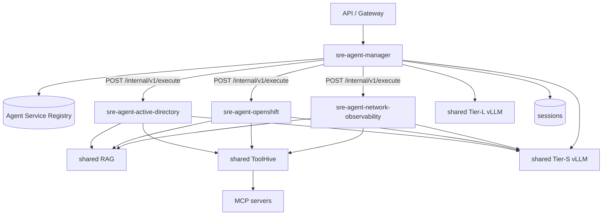

# Air-Gapped SRE Agent Platform — PoC SDD, Revision 2.0

**Status:** Implemented (PoC)
**Supersedes:** `docs/poc-sdd.md` (Rev 1) in the sections listed in the
changelog below; all other Rev 1 sections apply unchanged. Companion documents:
`docs/architecture-rev2.md` (decision + trade-offs) and
`docs/contracts/internal-agent-api.md` (normative wire contract).

## Changelog against Rev 1

| Rev 1 section | Change |
|---|---|
| §7 High-level architecture | one runtime process → one Deployment/Service per agent; new diagram below |
| §8.5 Specialist execution | local parallel invocation → distributed fan-out through `AgentClient` |
| §8.6 Round 2 | unchanged semantics; the second specialist is now reached over the internal API with the same handoff contract |
| §11 AuthN/AuthZ | Gate #1 extended across the manager→specialist hop (dual credential) |
| §13 Evidence model | `Evidence.agentId` attribution field added (required) |
| §14 Conversation state | unchanged model; the store is manager-owned (PostgreSQL/mock), keyed user+session |
| §15 Failure behavior | new distributed failure classes (§6 below) |
| §19 Deployment design | per-agent topology + generic Helm chart (§7 below) |
| §20 Observability | W3C trace context across services; single `sre.query` trace |
| §22.1 Load safety | storm profile additionally refuses a real agent client |
| everything else | unchanged |

## 1. Deployment model

> One Generic Agent Runtime implementation + one container image + one Helm
> chart + N agent configurations = N independently deployed Agents.

Each logical agent (manager, active-directory, openshift,
network-observability, later dba/exchange/...) is an OpenShift Deployment +
Service named `sre-agent-<name>`, running the same image with
`AGENT_CONFIG=agents/<name>.yaml`. Per agent: replicas, HPA, resource
requests/limits, ServiceAccount, NetworkPolicy, ownership labels, rollout and
health state, RAG collections, and ToolHive/MCP scope. Independent deployment
does **not** mean independent implementation — no per-agent code, image, or
chart exists.

## 2. Manager service

The manager deployment owns the whole deterministic control plane: Stage-1
routing, optional one-shot Manager LLM selection, authorization filtering,
bounded fan-out (`Promise.allSettled` over `agentClient.execute`),
`SpecialistResult` collection, `needsDomain` validation, one bounded Round 2,
evidence reduction, the synthesis gate, and final response construction.

The manager MUST NOT (and structurally cannot): expose specialist MCP tools to
its LLM, impersonate a specialist, grant permissions, bypass ToolHive, reach
infrastructure systems (its process builds no ToolHive/RAG client and its
NetworkPolicy has no egress to them), create agents dynamically, or make
recursive agent calls.

## 3. Internal Agent API and service discovery

The manager addresses agents logically by ID. The **Agent Service Registry**
(`agents/registry.yaml`, GitOps-generated, strict-schema, immutable at
startup) maps `agentId → { endpoint, owner, enabled, environments,
requiredRoles, allowedNeedsDomains }`; endpoints are the per-agent Service DNS
names. Unknown or disabled agents fail closed; the same registry drives
authorization filtering and the Round-2 discovery edges. The wire contract —
schemas, versioning, size limits (64 KiB / 512 KiB), deadlines, cancellation,
error mapping, dual-credential authentication — is normative in
`docs/contracts/internal-agent-api.md`.

## 4. Identity propagation (Architecture Gate #1, extended)

Every internal call carries the manager's workload identity **and** a signed,
audience-bound (`sre-agent:<agentId>`), short-lived (≤ 60 s) delegated user
JWT bound to the request ID and subject hash. The specialist verifies both
before executing; unsigned identity assertions are rejected. ToolHive then
authorizes each tool call against the verified human identity. Gate #1 now
requires distinguishable audit identities per user through
API → Manager → Specialist → ToolHive → MCP. The PoC proves the semantics
with a mock delegation authority; the enterprise token-exchange issuer is an
open integration point.

## 5. Specialist execution (unchanged core, new boundary)

A specialist receives only: the original question (redacted), verified
identity, environment, bounded conversation entities, and an optional
sanitized Round-2 handoff. It executes baseline RAG → Tier-S reasoning →
allowed MCP calls → redaction → `Evidence[]` → structured `SpecialistResult`,
all inside runtime-enforced budgets. Redaction completes **before** the result
leaves the process. Tool visibility remains
`YAML allowlist ∩ approved catalog ∩ user AuthZ ∩ environment policy`.

## 6. Distributed failure semantics

The manager distinguishes, as typed evidence and safe user-visible gaps:

| Condition | Transport code | Surfaced as |
|---|---|---|
| agent service down / disabled | `AGENT_UNAVAILABLE` (retried once) | `missing` evidence, degraded answer |
| agent deadline exceeded | `AGENT_TIMEOUT` | `missing` evidence |
| identity rejected | `AGENT_UNAUTHORIZED` | `denied` evidence |
| internal specialist failure | `AGENT_EXECUTION_FAILED` (HTTP 500) | `missing` evidence — never conflated with authorization |
| partial evidence | `status: "partial"` in-band | answer proceeds, gaps disclosed |
| oversized response | `AGENT_RESPONSE_TOO_LARGE` | `missing` evidence |

One specialist failure never cancels the others (`allSettled`). Retry
ownership is single per hop: manager→specialist once on transport
502/503/504; specialist→ToolHive per catalog `retryPolicy`; nothing else.

## 7. Deployment and network design

One generic Helm chart (`deploy/helm`), one release per agent
(`deploy/helm/values/<agent>.yaml`), producing per agent: Deployment, Service,
ServiceAccount, NetworkPolicy, optional HPA/PDB, optional ConfigMap-mounted
agent YAML override. Topology and install commands:
`deploy/openshift/README.md`.

NetworkPolicy shape: API namespace → manager only; specialists accept ingress
only from manager pods; manager egress = specialists + vLLM/IdP/PostgreSQL/OTel
(no ToolHive, no RAG); specialist egress = ToolHive/RAG/vLLM/OTel. The manager
never inherits the union of specialist network access.

## 8. Observability

One `requestId` and one W3C trace context flow
API → manager → each specialist → ToolHive/MCP. The manager injects
`traceparent` on every internal call; specialists extract it, so `sre.query`
spans `manager.route.stage1`, `manager.fanout`, `agent.<id>.execute` (both
sides), `rag.*`, `mcp.<server>.<tool>`, `round2.resolve`, `synthesis.*`,
`response.build` in a single distributed trace. Security audit (ToolHive →
SIEM) remains separate from application tracing.

## 9. Load and evaluation implications

- Per-service concurrency limits and HPA replace single-process tuning;
  the manager and each specialist saturate independently.
- The 50-user storm profile refuses to run unless **both** ToolHive and the
  agent client are mocks — a real agent client would storm deployed
  specialist services and, through them, real backends.
- The evaluation harness exercises the full distributed contract in-process
  (`InProcessAgentClient`: same admission checks, no TCP), keeping pass@1 /
  pass^8 measurement identical in semantics to the deployed path.

## 10. Future GUI

Unchanged vision, new outputs: creating an agent produces the agent YAML, a
registry entry, and a Helm values file — consumed by GitOps. The GUI generates
configuration, never runtime code.
