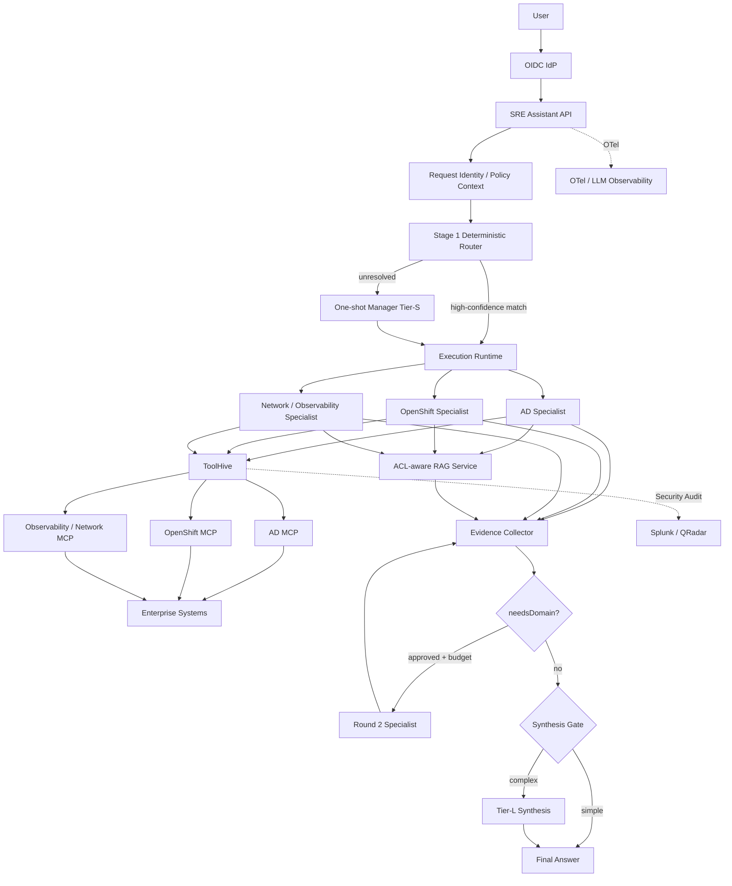

# Air-Gapped SRE Agent Platform — PoC SDD

**Document type:** System / Software Design Description (SDD)  
**Status:** Draft for PoC review  
**Scope:** Phase 1 — read-only Q&A  
**Architecture baseline:** `sre-agent-platform-architecture.md`, Rev 1.1  
**Deployment target:** Fully air-gapped on-premises OpenShift  
**Primary runtime:** Generic TypeScript Agent Runtime — TypeScript 7  
**Configuration:** YAML, Git as source of truth  
**MCP gateway:** ToolHive  
**Model serving:** Local OpenAI-compatible endpoints (vLLM or equivalent)

---

## 1. Purpose

This document defines the system-level design for a Proof of Concept of an internal SRE Agent Platform.

The PoC validates whether a small, generic TypeScript runtime can safely and reliably support:

- a bounded Manager Agent;
- multiple YAML-defined specialist agents;
- ACL-aware wiki/RAG retrieval;
- live read-only infrastructure queries through MCP via ToolHive;
- OIDC-based human identity;
- per-call authorization independent of LLM routing;
- typed evidence and provenance;
- controlled cross-domain fan-out;
- optional bounded second-round domain discovery;
- conditional large-model synthesis;
- full offline/OpenShift deployment.

The PoC is intended to prove the architecture, not to onboard all 13 infrastructure teams.

---

## 2. Background

The enterprise has 13 infrastructure teams spanning networking, security, Windows/identity, endpoint, storage/virtualization, Linux/platform, OpenShift, observability, operations/data services, DBA and DevOps tooling.

The current prototype uses n8n in the interactive request path and has unacceptable latency and orchestration overhead for the target experience.

The proposed architecture removes n8n from the synchronous request path and replaces it with a thin TypeScript runtime.

n8n may remain for asynchronous supporting workflows such as ingestion, indexing, notifications and administrative automation.

---

## 3. PoC goals

The PoC MUST validate the following.

### G-01 — Generic runtime

One runtime implementation can execute both Manager and specialist agents using configuration rather than agent-specific codebases.

### G-02 — Bounded Manager

A one-shot Manager can select one or more relevant specialist agents using structured output without becoming an iterative autonomous supervisor.

### G-03 — Deterministic control plane

Authentication, authorization, tool visibility, timeouts, retries, fan-out, second-round limits, evidence state and synthesis escalation are enforced by code, not by prompt.

### G-04 — Specialist isolation

Each specialist sees only:

- the original user question;
- trusted request metadata;
- its own system prompt;
- authorized wiki evidence;
- a curated 5–10 tool subset for the PoC;
- bounded execution state.

### G-05 — RAG + live evidence

A specialist can answer using both internal knowledge and live infrastructure state.

### G-06 — Identity propagation

The effective human identity and entitlements remain enforceable through:

```text
User
→ API
→ Runtime
→ Specialist
→ ToolHive
→ MCP
```

A shared privileged orchestrator identity MUST NOT collapse all user authorization into one service account.

### G-07 — Read-only by capability

No mutating operation can reach a backend even if the model requests one.

### G-08 — Evidence-first answers

Every material claim in the final answer is traceable to a typed evidence object or clearly marked as inference.

### G-09 — Failure transparency

Unavailable, stale, denied or empty sources remain visible in the answer and are never silently treated as healthy.

### G-10 — Air-gap deployability

The full PoC can be installed and operated with internal image/package/model mirrors and no external runtime dependency.

---

## 4. PoC non-goals

The PoC will NOT implement:

- infrastructure mutation or remediation;
- unrestricted supervisor loops;
- specialist-to-specialist invocation;
- A2A;
- durable long-running workflows;
- pause/resume;
- human approval workflows;
- autonomous root-cause analysis as a guaranteed capability;
- arbitrary workflow logic in YAML;
- long-term agent memory;
- cross-user memory;
- a production administration GUI;
- onboarding all 13 team MCP integrations.

---

## 5. PoC specialist scope

The PoC uses three specialists chosen to exercise different infrastructure patterns.

### 5.1 Active Directory Specialist

Representative capabilities:

- AD replication status;
- domain controller health;
- LDAP-based inventory/metadata;
- relevant Windows/Splunk event search;
- AD runbooks and standards.

### 5.2 OpenShift Specialist

Representative capabilities:

- pod state;
- namespace state;
- events;
- routes/services;
- cluster/workload health;
- OpenShift runbooks.

### 5.3 Network / Observability Specialist

Representative capabilities:

- Prometheus queries;
- selected network-state lookups;
- Splunk searches;
- network/observability runbooks.

The PoC SHOULD expose approximately 5–10 read-only tools per specialist.

---

## 5.4 PoC application stack decision

The PoC application stack is fixed as:

```text
Node.js 22 LTS
TypeScript 7
Express 5
Zod
MCP TypeScript SDK
OpenAI-compatible client
OpenTelemetry
YAML configuration
```

Express 5 is the HTTP/API shell only.

The Generic Agent Runtime MUST remain framework-independent at the domain layer so that routing, specialist execution, evidence handling, RAG, MCP and authorization logic do not depend on Express-specific request/response types.

TypeScript 7 is selected for the PoC implementation and build/tooling experience. This decision does not assume that TypeScript compiler improvements materially reduce LLM, MCP or RAG request latency; those external operations are expected to dominate end-to-end runtime latency.

## 6. Architectural principles

### 6.1 The Manager decides intent; code controls execution

> The Manager decides what should happen. The runtime decides what is allowed to happen and how it happens.

The Manager MAY select multiple specialists.

The Manager MUST NOT:

- grant authorization;
- change tool scope;
- call unrestricted tools;
- create new agents;
- generate free-form specialist instructions;
- alter execution limits.

### 6.2 YAML defines WHAT; TypeScript defines HOW

YAML may describe:

- identity;
- type;
- model tier;
- system prompt;
- RAG collections;
- MCP servers;
- tool allowlist;
- agent relationships;
- limits;
- authorization metadata.

YAML MUST NOT contain:

- loops;
- workflow branches;
- executable expressions;
- custom code;
- retry algorithms;
- persistence/resume logic.

### 6.3 Evidence, not transcripts, crosses boundaries

Specialists and synthesis stages exchange structured evidence and typed summaries.

Full internal LLM transcripts MUST NOT be passed between specialists.

### 6.4 Untrusted content remains data

Wiki text, log bodies, alert annotations, object descriptions and MCP payloads are untrusted data.

They MUST NOT be able to change:

- routing policy;
- authorization;
- available agents;
- available tools;
- system instructions;
- read-only capability.

---

## 7. High-level architecture



---

## 8. Request lifecycle

### 8.1 Authentication

1. User authenticates through the enterprise OIDC provider.
2. API validates the token.
3. Runtime creates a trusted `RequestIdentity`.
4. Authorization is re-evaluated at every protected boundary.

Minimum identity context:

```ts
interface RequestIdentity {
  subject: string;
  groups: string[];
  roles: string[];
  requestId: string;
  sessionId?: string;
}
```

### 8.2 Stage-1 deterministic routing

Before a routing model is invoked, the runtime attempts high-precision routing using trusted data:

- exact platform terminology;
- known hostname patterns;
- CMDB ownership;
- explicit team/system identifiers;
- configured lexical mappings.

Examples:

```text
"AD replication"      → AD Specialist
"CrashLoopBackOff"    → OpenShift Specialist
"PromQL"              → Network / Observability Specialist
```

The deterministic router is tuned for **precision, not coverage**.

Ambiguous terms such as `cluster`, `replication`, `policy`, `gateway`, `node` or `certificate` MUST NOT be aggressively mapped without supporting context.

### 8.2.1 Intent classification

The PoC does not add a separate hidden LLM call for intent classification.

`intent` is derived deterministically from:

- explicit question forms and diagnostic language handled by Stage-1 routing;
- trusted entity/context features;
- allowlisted `reasonCodes` emitted by the Manager when Stage-1 is unresolved.

The runtime normalizes these into:

```ts
type RequestIntent =
  | "factual"
  | "diagnostic"
  | "procedural"
  | "ambiguous";
```

Manager `reasonCodes` may affect this enum only through a fixed runtime mapping. Free-form Manager text is never executable policy.

### 8.3 Manager routing

If deterministic routing cannot resolve the request, the one-shot Manager receives:

- original user question;
- trusted entity metadata;
- list of currently authorized specialist descriptors.

It emits schema-constrained selection only:

```ts
interface ManagerDecision {
  agents: string[];
  confidence: number;
  alternates?: string[];
  abstain: boolean;
  reasonCodes?: string[];
}
```

The Manager MUST NOT generate specialist task text.

### 8.4 Abstention

If `abstain=true`:

- if policy permits a bounded top-2 ambiguity fan-out, the runtime MAY execute the top two valid candidates;
- otherwise the runtime returns a clarification request;
- no MCP tool is called until an allowed route exists.

### 8.5 Specialist execution

Each selected specialist runs independently and, when possible, in parallel.

Each specialist receives:

- original question;
- resolved conversation entities;
- environment;
- trusted metadata;
- baseline RAG evidence;
- authorized tools only.

### 8.6 Round 2 discovered routing

A specialist MAY return:

```ts
interface SpecialistResult {
  evidence: Evidence[];
  needsDomain?: string[];
  summary?: string;
}
```

For the PoC:

- at most one additional domain may be added;
- only one second round is permitted;
- authorization is re-evaluated;
- the requested domain must exist in the registry;
- the second specialist receives the original question plus a sanitized typed handoff;
- raw untrusted payloads and transcripts MUST NOT be propagated directly.

### 8.7 Synthesis

Tier-L is invoked only when deterministic policy decides it is needed, for example:

- multiple specialists contributed;
- evidence conflicts;
- relevant evidence is missing/stale;
- the question is diagnostic rather than factual.

Single-specialist factual answers SHOULD bypass Tier-L.

When Tier-L is not used, the final answer is built from:

1. the specialist's structured `summary`;
2. deterministic citation rendering from `Evidence[]`;
3. deterministic evidence-gap and degraded-state banners.

The runtime does not invoke another model to rewrite this answer path.

---

## 9. RAG design

### 9.1 Baseline retrieval

RAG is not an optional tool-call decision.

For every RAG-enabled specialist, baseline retrieval runs before tool reasoning.

```text
Question
→ ACL filter
→ lexical + dense retrieval
→ rank fusion
→ reranking
→ top authorized chunks
→ Evidence[]
```

### 9.2 Follow-up retrieval

One additional retrieval MAY be requested when the specialist discovers a new entity from live evidence.

Example:

```text
live MCP discovers hostname APP-PRD-114
→ one follow-up wiki lookup for APP-PRD-114/runbook
```

### 9.3 ACL

Document/chunk entitlement filtering MUST happen inside retrieval before content enters model context.

Post-generation filtering is not acceptable.

### 9.4 Redaction

Before any wiki or MCP payload enters a model context:

1. normalize;
2. redact known secrets and sensitive tokens;
3. apply size limits;
4. preserve evidence provenance;
5. record redaction metadata.

The PoC MUST validate that secrets contained in logs/configuration cannot be echoed into Tier-S/Tier-L output.

---

## 9.5 Context and evidence budgets

Context size is a runtime-owned control, not a prompt instruction.

Initial PoC defaults:

```text
maxEvidenceBytesPerSpecialist: 256 KiB
maxContextTokensPerSpecialist: 12,000
maxEvidenceItemsPerSpecialist: 32
maxRawExcerptBytesPerEvidence: 8 KiB
```

These are PoC starting values and MUST be validated against the selected Tier-S model and actual wiki/tool payloads.

Truncation ownership:

- the RAG service ranks candidate chunks;
- the Evidence normalizer records the original payload size;
- the TypeScript runtime owns final inclusion/truncation before model invocation;
- the model never decides whether provenance or security metadata may be dropped.

Reduction order:

1. preserve trusted request metadata;
2. preserve evidence status and provenance;
3. preserve the highest-ranked RAG evidence;
4. preserve compact structured tool results;
5. truncate `rawExcerpt` before dropping evidence objects;
6. if an evidence object is shortened, set `truncated=true` and preserve `originalSizeBytes`.

## 10. MCP and ToolHive design

All live access is:

```text
Runtime
→ ToolHive
→ MCP server
→ infrastructure system
```

### 10.1 ToolHive responsibilities

ToolHive owns:

- MCP connectivity;
- MCP server lifecycle;
- gateway authentication integration;
- per-call authorization;
- allow/deny policy;
- gateway rate limiting;
- gateway audit;
- security-relevant tool exposure.

### 10.2 Runtime responsibilities

The runtime owns:

- tool selection from an already-authorized subset;
- tool execution budget;
- timeouts;
- correlation IDs;
- response normalization;
- evidence conversion;
- concurrency.

Retry ownership MUST be unambiguous. The PoC design assigns retry policy to the runtime unless a specific backend integration explicitly documents otherwise.

Nested retry loops are prohibited.

### 10.3 Tool budget

Each specialist SHOULD see 5–10 tools in the PoC.

The PoC will measure behavior at multiple tool counts before fixing a production limit.

---

## 11. Authentication and authorization

### 11.1 Authentication

OIDC identifies the human user.

### 11.2 Authorization

Authorization is external to the LLM.

Authorization MAY consider:

```text
subject
group
role
environment
agent
MCP server
tool
method
resource
```

### 11.3 Architecture Gate #1 — identity propagation

Before evaluating routing or model quality, the PoC MUST prove:

1. user A and user B produce distinguishable audit identities;
2. the runtime does not flatten both users into one globally privileged principal;
3. ToolHive evaluates the effective user/entitlement context;
4. denied calls are visible in the gateway audit log;
5. a user cannot gain a tool simply because the Manager selected an agent.

If this gate fails, the PoC stops.

---

## 12. Read-only enforcement

Read-only MUST hold independently at three layers.

### Layer 1 — Tool exposure

Only tools whose real backend behavior was reviewed and verified as read-only are registered/exposed.

Names such as `get_*` are documentation only.

### Layer 2 — Backend credentials

MCP servers use backend identities that are incapable of mutation.

### Layer 3 — Network/API controls

Network and API policy prevent write paths where practical.

Read APIs that require `POST` must be explicitly allowlisted by path rather than relying only on HTTP verb filtering.

---

## 13. Evidence model

```ts
type EvidenceStatus =
  | "ok"
  | "empty"
  | "missing"
  | "failed"
  | "stale"
  | "denied";

interface Evidence {
  id: string;
  kind: "wiki" | "telemetry" | "config" | "missing";

  source: string;
  system: string;
  environment: string;

  observedAt?: string;
  sourceModifiedAt?: string;

  tool?: string;
  query?: string;

  payload?: unknown;
  rawExcerpt?: string;

  confidence?: number;
  citation: string;
  status: EvidenceStatus;

  requestId: string;

  redaction?: {
    applied: boolean;
    categories?: string[];
  };

  truncated?: boolean;
  originalSizeBytes?: number;
}
```

Important distinction:

- `observedAt` = when live state was observed;
- `sourceModifiedAt` = when a static source was last modified.

---

## 14. Conversation state

Phase 1 supports bounded follow-up context.

Session state MAY retain:

- explicit entities;
- previous user-visible references;
- prior request IDs;
- small routing hints.

Session state MUST NOT be treated as:

- durable agent memory;
- authorization state;
- automatically current infrastructure evidence;
- cross-user memory.

A follow-up request causes authorization and routing to run again.

Live evidence is always refreshed in the PoC. No freshness-based evidence reuse policy is implemented.

---

## 15. Failure and degradation behavior

### 15.1 MCP timeout

Return `missing`/`failed` evidence and continue with other sources.

### 15.2 MCP unavailable

Isolate failure to that MCP source.

### 15.3 ToolHive unavailable

No live evidence is available. Wiki-only response is allowed only with an explicit degraded-mode warning.

### 15.4 Wiki unavailable

Live-only answer may continue with an explicit knowledge-gap warning.

### 15.5 Empty result

`empty` is not equivalent to `healthy`.

### 15.6 Stale result

Evidence remains visible but is marked stale.

### 15.7 Wiki/live conflict

Both are shown with timestamps. No silent conflict resolution.

### 15.8 Partial fan-out

If at least one specialist returns usable evidence, synthesis may proceed, but every unavailable expected source must be disclosed.

---

## 16. Security controls

The PoC MUST include tests for:

- direct prompt injection;
- indirect prompt injection through wiki;
- injection through log payload;
- injection through alert annotation;
- tool catalogue disclosure;
- unauthorized environment access;
- cross-user session leakage;
- secret leakage;
- confused deputy;
- write-intent requests.

Security principle:

> Authorization safety and behavioral integrity are different problems.

Hard AuthZ prevents privilege escalation. Redaction, context separation, bounded plans and evaluation mitigate behavioral corruption.

---

## 17. YAML security and GitOps

Agent YAML is security-sensitive configuration.

A change to:

```yaml
allowedTools:
```

is a permissions-affecting change even if no application code changed.

PoC repository policy SHOULD require:

- JSON Schema validation;
- semantic validation;
- owner review;
- security review for tool/auth changes;
- protected main branch;
- immutable version/tag for deployments;
- rollback through Git;
- no direct production GUI writes bypassing Git.

Future GUI changes SHOULD produce the same reviewed configuration artifact.

---

## 18. Structured output enforcement

Structured outputs used for control decisions MUST be enforced at the model-serving layer where supported and validated again in TypeScript.

Examples:

- `ManagerDecision`;
- `needsDomain`;
- specialist status/result envelope.

The preferred pattern is:

```text
guided / constrained JSON generation
+
TypeScript schema validation
+
bounded correction or failure
```

A free-form model response followed only by permissive JSON parsing is insufficient.

---

## 19. Deployment design

Recommended namespaces:

```text
sre-assistant
  Express 5 API
  TypeScript 7 runtime
  RAG service
  session service

sre-mcp
  ToolHive
  AD MCP
  OpenShift MCP
  Network/Observability MCP

sre-models
  Tier-S vLLM
  Tier-L vLLM
  embedding/reranking

sre-observability
  OTel Collector
  tracing backend

sre-data
  PostgreSQL / vector index
```

Default-deny network policy SHOULD be applied.

All packages, images, charts and model artifacts MUST be mirrored internally.

---

## 20. Observability and audit

Every request receives a `requestId`.

OpenTelemetry spans SHOULD include:

```text
request
authn
route.stage1
route.manager
rag.baseline
specialist.<id>
mcp.<server>.<tool>
rag.followup
round2
synthesis
response
```

Security audit is separate from LLM/application trace data.

ToolHive authorization/audit logs SHOULD be sent to the enterprise SIEM.

---

## 21. Performance objectives

Initial PoC targets:

| Stage | p95 objective |
|---|---:|
| Stage-1 routing | < 50 ms |
| Manager routing when needed | < 500 ms |
| RAG baseline | < 800 ms |
| Typical parallel MCP phase | < 3 s |
| Specialist reasoning | < 2.5 s |
| Tier-L synthesis | < 4 s |
| End-to-end simple query | < 5 s |
| End-to-end cross-domain query | < 8 s |

These are PoC targets, not production SLOs.

All stage latency MUST be measured separately.

---

## 22. PoC acceptance criteria

### Security gates

| Metric | Target |
|---|---:|
| Tool policy violations | 0 |
| Mutating backend operations | 0 |
| Cross-user leakage | 0 |
| Identity propagation | PASS |
| Unauthorized wiki retrieval | 0 |

### Quality

| Metric | Target |
|---|---:|
| Correct routing | >95% |
| Correct tool selection | >95% |
| Invalid MCP calls | <1% |
| Citation correctness | >95% |
| Unsupported claims | <2% |
| Missing-evidence disclosure | 100% |
| Cross-domain success | >90% |

### Consistency

Run repeated trials and report:

- `pass@1`;
- `pass^8`;
- semantically equivalent routing consistency;
- unnecessary fan-out;
- missed domains.

### Performance

Measure:

- p50/p95 latency;
- latency per stage;
- tool calls/request;
- model calls/request;
- token usage;
- GPU-seconds/request;
- Tier-L escalation rate.

---

## 22.1 Load-test safety policy

Read-only does not imply load-safe.

- **1–5 concurrent users:** approved real read-only backends may be used with owner coordination.
- **20 concurrent users:** real backends require explicit owner approval, safe query profiles and rate limits; otherwise use lab/replay MCPs.
- **50-user incident-storm tests:** use mock, replay, lab or synthetic MCP backends by default.

Production Splunk, LDAP, database and network APIs MUST NOT receive a synthetic 50-user storm merely because the operations are read-only.

## 22.2 Evaluation grading protocol

### Unsupported claims

Target: `<2%`.

A pinned local Tier-L model acts as the automated judge using a fixed rubric. It receives only:

- the user question;
- the final answer;
- the cited `Evidence[]`.

It emits structured claim-level support verdicts.

At least 20% of cases, plus every security-sensitive failure, are manually reviewed.

### Citation correctness

Target: `>95%`.

A citation passes only when:

- the referenced evidence object exists;
- the user was entitled to that evidence;
- the evidence materially supports the cited statement;
- environment and timestamps are represented correctly.

Judge model, prompt, rubric and version are stored with every benchmark run. The automated judge is an evaluation instrument, not ground truth.

## 23. PoC execution order

### Gate 1 — Identity and authorization

Prove identity propagation and deny behavior before agent logic.

### Gate 2 — Direct specialist

Run one specialist directly with RAG + MCP.

### Gate 3 — Tool quality

Validate 5–10 tool schemas and small-model tool calling.

### Gate 4 — Manager routing

Introduce Stage-1 router and one-shot Manager.

### Gate 5 — Parallel fan-out

Run two/three specialists in parallel.

### Gate 6 — Round 2

Validate `needsDomain` bounded second-round behavior.

### Gate 7 — Failure/adversarial

Run partial failure, injection, redaction and stale evidence tests.

### Gate 8 — Load

Test 20 and 50 concurrent users.

---

## 24. Architecture risks

### R-01 — Identity propagation fails

Impact: Critical.  
Mitigation: PoC Gate #1.

### R-02 — 3–8B tool calling is not accurate enough

Impact: High.  
Mitigation: test multiple model families/sizes and tool budgets.

### R-03 — Custom runtime expands into a framework

Impact: High.  
Mitigation: enforce red lines.

### R-04 — MCP onboarding dominates delivery effort

Impact: High.  
Mitigation: only three specialists in PoC; establish MCP contract and onboarding checklist.

### R-05 — Wiki quality/ACL metadata is inadequate

Impact: High.  
Mitigation: validate RAG on a controlled subset with known ownership and permissions.

### R-06 — Redaction removes useful diagnostic context

Impact: Medium.  
Mitigation: measure answer quality with bounded raw excerpts and redaction categories.

### R-07 — Round-2 routing creates hidden autonomy

Impact: Medium.  
Mitigation: one additional domain, one round, deterministic trigger and authorization.

---

## 25. Red lines

Stop extending the custom runtime and evaluate a workflow/orchestration engine if the implementation requires:

- configurable loops;
- arbitrary conditional workflows;
- durable execution;
- pause/resume;
- long-running workflow persistence;
- human approval checkpoints;
- compensation;
- subgraph composition;
- specialist-to-specialist invocation;
- agent memory affecting execution policy;
- streaming orchestration state that becomes a graph problem.

The PoC must remain a thin runtime, not an internally developed LangGraph/Temporal/n8n replacement.

---

## 26. Success decision

The PoC architecture is considered viable if:

1. identity propagation and read-only guarantees pass with zero violations;
2. small-model tool selection meets quality targets;
3. Manager routing provides useful flexibility without unacceptable `pass^8` degradation;
4. cross-domain fan-out remains bounded and inspectable;
5. RAG provides ACL-correct, useful evidence;
6. end-to-end latency materially improves over the current n8n prototype;
7. the core runtime remains small, understandable and testable;
8. no red-line framework features are required.

If these conditions do not hold, the next decision is not “add more prompting”; it is to revisit model tiering, routing design, framework adoption or scope.
